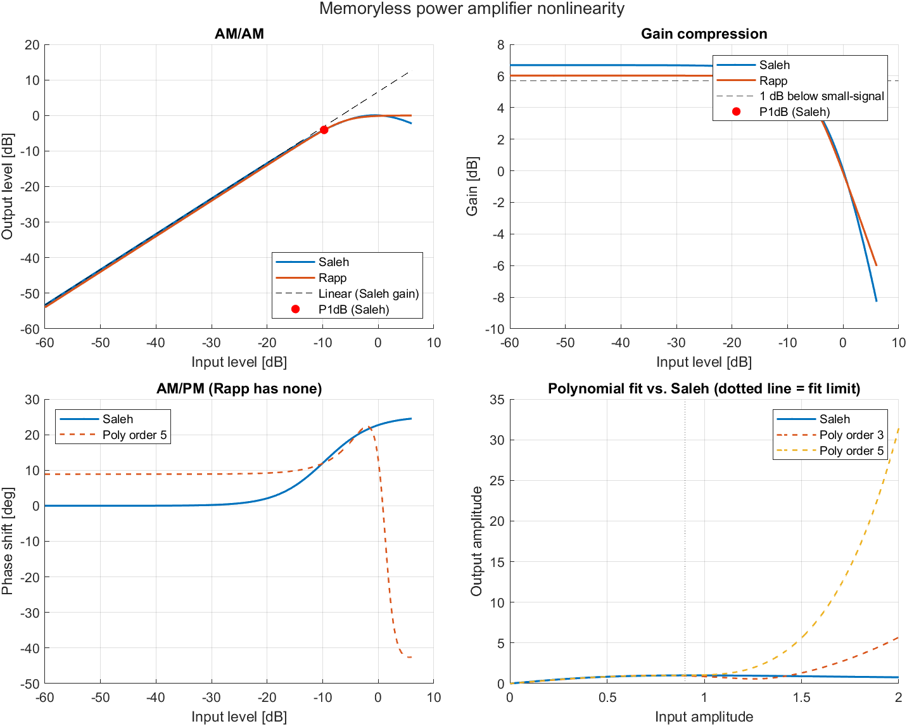

# Memoryless Power Amplifier Modeling (AM/AM, AM/PM, P1dB)


## Purpose
Power amplifiers (PAs) compress and distort the signals they amplify. This
project models that behavior with memoryless Saleh and Rapp models and an
odd-order polynomial fit, and plots AM/AM, AM/PM, gain compression and the
1 dB compression point (P1dB). It is the basis for digital predistortion (DPD)
and linearity analysis.

## Requirements
- MATLAB R2021a or newer (uses `arguments` blocks, `exportgraphics`, `tiledlayout`). Tested on R2022b.
- No toolboxes required

## Usage
```matlab
startup
run scripts/main.m
runtests('tests')      % 6 unit tests, all passing
for f = dir('src/*.m'), checkcode(fullfile(f.folder, f.name)), end  % static analysis
```
The figure is saved to `results/pa_nonlinearity.png` (generated on first run;
commit it so it shows here).



## Structure
| Path | Description |
|---|---|
| `src/pa_config.m` | All parameters (no magic numbers elsewhere) |
| `src/pa_saleh.m` | Saleh AM/AM + AM/PM model |
| `src/pa_rapp.m` | Rapp AM/AM model |
| `src/pa_poly_fit.m`, `pa_poly_eval.m` | Odd-order (3, 5) complex polynomial fit/evaluation |
| `src/find_p1db.m` | P1dB search with interpolation |
| `scripts/main.m` | Runs everything, prints metrics, saves the figure |
| `tests/PaModelTest.m` | Unit tests, incl. closed-form Saleh P1dB check |

## Validation
For Saleh, G(r) = a/(1+b r²), so the input P1dB amplitude is
r = sqrt((10^(1/20) − 1)/b). The unit test checks the numeric result against it.

## Results

Output of `run scripts/main.m` (MATLAB, seed 42, normalized amplitudes):

| Model | Small-signal gain | Input P1dB | Output P1dB |
|---|---|---|---|
| Saleh | 6.68 dB | −9.75 dB | −4.07 dB |
| Rapp (p = 2) | 6.02 dB | −7.19 dB | −2.16 dB |

| Polynomial fit (to Saleh, r ≤ 0.9) | NMSE |
|---|---|
| Order 3 | −26.2 dB |
| Order 5 | −33.1 dB |

The Saleh input P1dB matches the closed-form value sqrt((10^(1/20) − 1)/β_a) ≈ 0.3255 (−9.75 dB).


## Assumptions and limitations
- Memoryless (no frequency dependence or memory effects).
- Amplitudes are normalized, not absolute dBm.
- Polynomial fits are valid only inside the fitted range (`cfg.poly.fit_max`);
  outside it they diverge, unlike the saturating physical model.
- Parameters are textbook values, not measurements of a real PA.

## References
1. A. A. M. Saleh, "Frequency-independent and frequency-dependent nonlinear models of TWT amplifiers," IEEE Trans. Commun., vol. 29, no. 11, 1981.
2. C. Rapp, "Effects of HPA-nonlinearity on a 4-DPSK/OFDM signal for a digital sound broadcasting system," ESA SP-332, 1991.
3. L. Ding et al., "A robust digital baseband predistorter constructed using memory polynomials," IEEE Trans. Commun., 2004.

## Contact
- Email: i.zarnegarpanah@gmail.com
- LinkedIn: https://www.linkedin.com/in/iman-zarnegar-panah

## License
MIT License, Copyright (c) 2026 Iman Zarnegar. See [LICENSE](LICENSE).
