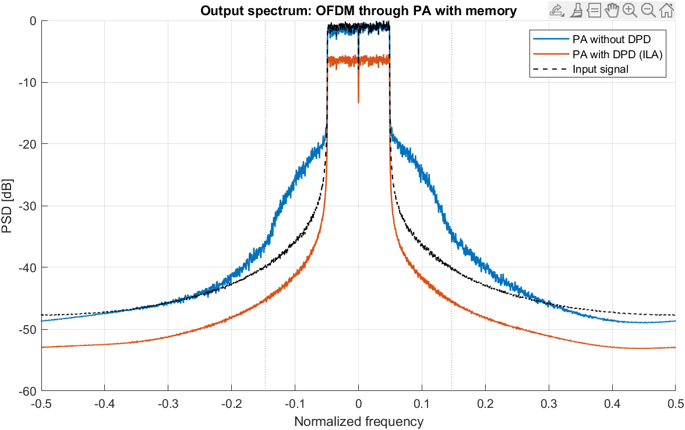

# Power Amplifier Nonlinearity: Modeling, ACPR/EVM and DPD (MATLAB)

## Purpose
Power amplifiers (PAs) compress and distort the signals they amplify. This
project models that behavior with memoryless Saleh and Rapp models and an
odd-order polynomial fit, and plots AM/AM, AM/PM, gain compression and the
1 dB compression point (P1dB). It also measures the effect of PA distortion on
OFDM signals with ACPR and EVM, and linearizes the PA with memory polynomial
digital predistortion (DPD) using indirect learning (ILA).

Scope:
- Memoryless models: Saleh and Rapp, odd-order polynomial fit, AM/AM, AM/PM, P1dB
- Memory model: Wiener-Hammerstein PA (input FIR, Saleh nonlinearity, output FIR)
- OFDM test signal (16-QAM, CP-OFDM, PAPR clipping)
- Metrics: ACPR (Welch PSD), EVM, NMSE
- DPD: memory polynomial (MP) with ILA

## Requirements
- MATLAB R2021a or newer (uses `arguments` blocks, `exportgraphics`, `tiledlayout`). Tested on R2022b.
- No toolboxes required

## Usage
Run these commands in MATLAB from the project root:

    startup
    run scripts/main.m          % memoryless PA models
    run scripts/main_dpd.m      % OFDM, ACPR/EVM, DPD
    runtests('tests')           % 10 unit tests, all passing
    for f = dir('src/*.m'), checkcode(fullfile(f.folder, f.name)), end  % static analysis

Figures are saved to `results/` on first run (commit them so they show here):
- `results/pa_nonlinearity.png`: AM/AM, AM/PM, compression
- `results/dpd_spectrum.png`: OFDM spectrum with and without DPD

## Structure
| Path | Description |
|---|---|
| `src/pa_config.m` | All parameters (no magic numbers elsewhere) |
| `src/pa_saleh.m`, `src/pa_saleh_cx.m` | Saleh AM/AM + AM/PM (real amplitude and complex baseband) |
| `src/pa_rapp.m` | Rapp AM/AM model |
| `src/pa_memory.m` | Wiener-Hammerstein PA with memory |
| `src/pa_poly_fit.m`, `src/pa_poly_eval.m` | Odd-order (3, 5) complex polynomial fit/evaluation |
| `src/find_p1db.m` | P1dB search with interpolation |
| `src/mp_basis.m`, `src/mp_fit.m`, `src/mp_eval.m` | Memory polynomial basis, least-squares fit, evaluation |
| `src/dpd_ila.m` | ILA-based DPD iteration |
| `src/ofdm_generate.m`, `src/papr_clip.m` | OFDM test signal and PAPR clipping |
| `src/psd_welch.m`, `src/calc_acpr.m` | Welch PSD (Hann, 50% overlap) and worst-case ACPR |
| `src/calc_evm.m`, `src/calc_nmse.m` | EVM (single complex gain) and NMSE |
| `scripts/main.m` | Memoryless models: metrics and figure |
| `scripts/main_dpd.m` | OFDM + DPD: ACPR, EVM and spectrum figure |
| `tests/PaModelTest.m` | Unit tests (10), incl. closed-form Saleh P1dB check |

## Validation
For Saleh, G(r) = a/(1+b r²), so the input P1dB amplitude is
r = sqrt((10^(1/20) − 1)/b). The unit test checks the numeric result against it.

EVM uses one complex gain (least-squares), not per-subcarrier equalization,
so memory effects are not hidden.

## Results

### Memoryless models
Output of `run scripts/main.m` (MATLAB, seed 42, normalized amplitudes):

| Model | Small-signal gain | Input P1dB | Output P1dB |
|---|---|---|---|
| Saleh | 6.68 dB | −9.75 dB | −4.07 dB |
| Rapp (p = 2) | 6.02 dB | −7.19 dB | −2.16 dB |

| Polynomial fit (to Saleh, r ≤ 0.9) | NMSE |
|---|---|
| Order 3 | −26.2 dB |
| Order 5 | −33.1 dB |

The Saleh input P1dB matches the closed-form value sqrt((10^(1/20) − 1)/β_a) ≈ 0.3255 (−9.75 dB).

### OFDM, ACPR/EVM and DPD
Output of `run scripts/main_dpd.m` (MATLAB, seed 42, 16-QAM, 200 subcarriers, PAPR clipped to 8 dB, MP K=7, Q=3, 3 ILA iterations):

| Metric | Without DPD | With DPD |
|---|---|---|
| ACPR (worst adjacent channel) | −29.2 dB | −38.0 dB |
| EVM | 13.78 % | 0.91 % |

## Assumptions and limitations
- Memoryless models have no frequency dependence. The Wiener-Hammerstein model is a simple memory model, not a measured PA.
- Amplitudes are normalized, not absolute dBm.
- Polynomial fits are valid only inside the fitted range (`cfg.poly.fit_max`);
  outside it they diverge, unlike the saturating physical model.
- DPD converges only when the target gain is near the linear region. At higher drive (gain above about 1.2–1.6) the PA saturates and ILA diverges.
- All parameters are textbook or synthetic values, not measurements of a real PA.

## References
1. A. A. M. Saleh, "Frequency-independent and frequency-dependent nonlinear models of TWT amplifiers," IEEE Trans. Commun., vol. 29, no. 11, 1981.
2. C. Rapp, "Effects of HPA-nonlinearity on a 4-DPSK/OFDM signal for a digital sound broadcasting system," ESA SP-332, 1991.
3. L. Ding et al., "A robust digital baseband predistorter constructed using memory polynomials," IEEE Trans. Commun., vol. 52, no. 1, 2004.

## Contact
- Email: i.zarnegarpanah@gmail.com
- LinkedIn: https://www.linkedin.com/in/iman-zarnegar-panah

## License
MIT License, Copyright (c) 2026 Iman Zarnegar. See [LICENSE](LICENSE).
`
